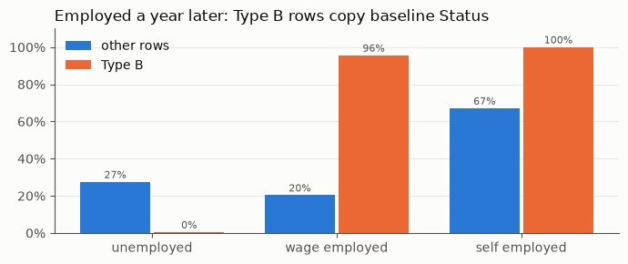
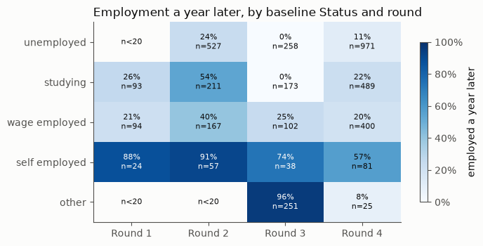
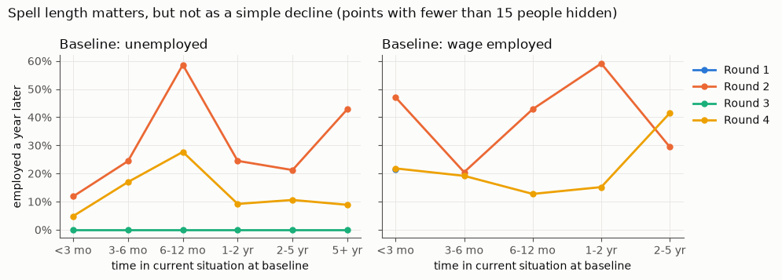
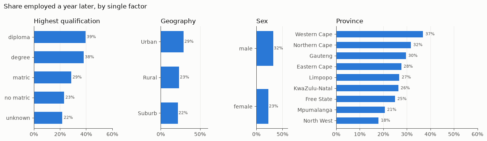

# Youth Income Prediction: 1st place, and a leak I chose not to use

**Predictive Insights Youth Income Prediction Challenge, Zindi (SA Ambassador Hack), November 2026**
**Result: 1st on the private leaderboard, ROC AUC 0.8743** (public 0.8648). Built with PriorLabs-TabPFN.

> This repository is a write-up only. Zindi's rules assign the copyright of top-3 solutions to Zindi, so the solution code isn't published here, and competition data may never be redistributed. Every figure shows aggregates only, and the code snippets are short illustrations written for this page.
>
> The top-10 code review was submitted on 22 Nov 2026; the outcome is pending.

## The problem

Predictive Insights asked which young South Africans would be employed a year after a baseline labour-market survey, and what drives that outcome.

- **Data:** 4,020 labelled people and 1,934 to predict, from four survey rounds six months apart. Each row is one baseline interview: labour-market status, how long the person has been in that status (`Tenure`, in days), schooling, province, and a few demographics. 27% of the training people were employed a year later.
- **Metric:** ROC AUC on the predicted probabilities, so the task is ranking people by their chance of employment. The public leaderboard used about 20% of the test rows (about 387 people), the private one about 80%.
- **Rules:** only the provided data, no AutoML.

With 387 public rows, the public AUC has a standard deviation of about 0.02. That is larger than most of the improvements I was trying to measure, so cross-validation had to make every decision.

## Validation first

Before modelling, I checked that the local setup measured the right thing:

- **The metric.** I rebuilt the starter-notebook model. Its CV under ROC AUC (0.676) matched its leaderboard score (0.664); PR AUC (0.48) and accuracy (0.81) didn't.
- **Train and test are one sample.** An adversarial classifier couldn't tell them apart (AUC 0.485), the status-by-round mix matched (p = 0.63), and no IDs overlapped.
- **The CV scheme.** Stratified 5-fold, repeated three times with fixed seeds: 15 folds.
- **Comparisons are paired.** Every change was compared with its parent on identical folds, using the Nadeau–Bengio corrected t-test. Folds share most of their training rows, so a plain paired t-test overstates significance.

```python
# Illustration, not the solution code: the corrected resampled t-test
# (Nadeau & Bengio, 2003) for a paired comparison over k CV folds.
def corrected_t(diffs, n_train, n_test):
    k = len(diffs)
    mean = sum(diffs) / k
    var = sum((d - mean) ** 2 for d in diffs) / (k - 1)
    # Inflate the variance for the overlap between training sets.
    se = (var * (1 / k + n_test / n_train)) ** 0.5
    return mean / se   # compare with a t distribution, k - 1 degrees of freedom
```

A change was kept only if it won on both fold seeds, survived an ablation, and kept its lead under the leak check described below.

## A leak in `Tenure`: found, measured, not used

Early on I noticed something odd about `Tenure`. For about a quarter of rows, the start date implied by the survey date minus `Tenure` fell exactly 5 or 6 days before the survey's day of the month. I called these Type B rows. In them the outcome almost copies the baseline status:



Why I read it as a data-construction artefact and not a labour-market effect:

- **It depends on the day of the month,** not on how long the spell lasted.
- **The counts are implausible.** Start dates should spread evenly across the month, about 40 rows per offset; two offsets held 972 rows.
- **It works in both directions,** keeping the employed employed as strongly as the unemployed unemployed.
- **It grows round by round:** 0%, 12%, 19%, then 36% of rows.

A model built on it would score about 0.88–0.90 in CV, above anything I built without it. It would also be useless for the client: a new survey cohort wouldn't carry the artefact. So I built no feature from it, never used the survey date as an input, and never uploaded a leak-based file to probe the leaderboard.

**The test I used on every change: shift `Tenure` by up to ±7 days.** 400 and 407 days mean the same thing for finding a job, so a shift keeps the genuine spell-length signal and destroys the exact day count the artefact lives in. Quarter-rounded `Tenure` still adds 0.033 AUC outside Type B rows, so spell length itself is real signal; a Type B flag rebuilt from shifted `Tenure` adds nothing.

**Where this check caught me, and what I did about it.** I compared each step only with the one before it. Each step passed, but small `Tenure`-sensitive gains accumulated. Measured against the simpler model, my best model's whole lead disappears under the shift (+0.005 → 0.000). Rather than hide that, I submitted both models (see the final picks) and disclosed the numbers in the solution documentation.

## The model journey

| Step | CV AUC | Public AUC |
|---|---|---|
| LightGBM, default settings, raw columns | 0.849 | 0.857 |
| Best tree ensemble (two LightGBMs and CatBoost, rank-averaged) | 0.861 | not uploaded |
| **TabPFN v2**, raw columns | 0.873 | 0.864 |
| + survey round as a categorical column | 0.875 | 0.863 |
| + a duration feature (`Dur`) | 0.876 | 0.862 |
| + six fine-tuned TabPFN v2 checkpoints, 5-seed average | 0.878 | 0.865 |

**Gradient-boosted trees first.** Feature engineering for the trees (status-by-round interactions, numeric grade bands, age, education summaries) moved CV less than its noise. kNN (0.706), an MLP (0.813), a hierarchical logistic model (0.825) and TabICL (0.863) didn't improve a blend either.

**TabPFN v2 changed the picture.** It's a transformer pre-trained on millions of synthetic tabular tasks; it reads the labelled rows and predicts the new ones in one forward pass, with no fitting to this data. With 4,020 rows, its learned prior beat the best tree ensemble by 0.012 AUC and won all 15 folds. It ran on a laptop CPU.

**Round as a category.** The same baseline status means different things in different rounds, because each cohort met a different labour market. Treating round as a category instead of a number gave +0.002, growing to +0.003 under the `Tenure` shift.

**A duration feature from labour economics.** The chance of finding work changes with time spent in the current situation (duration dependence), and the curve differs for the unemployed, the employed and students. For each status I fitted a small logistic curve of the outcome on log-tenure and its square, inside each training fold only, and passed its log-odds to TabPFN as one extra column.

```python
# Illustration, not the solution code: one duration curve per baseline status,
# fitted on the training fold only, applied to both training and held-out rows.
for status in statuses:
    rows = train_fold[train_fold.status == status]
    x = log1p(rows.tenure)
    curve = LogisticRegression().fit(column_stack([x, x**2]), rows.target)
    # fewer than 50 rows: fall back to one curve fitted on all statuses
    dur[status] = curve.decision_function(...)   # log-odds as the feature
```

**Fine-tuned checkpoints, seed-averaged.** Prior Labs publishes six fine-tuned TabPFN v2 checkpoints. Spreading 12 ensemble members across them and averaging five seeds added +0.003 over the single-checkpoint model, winning all 10 folds I could afford to run (each fold took about 9 minutes per seed on CPU). The checkpoints help only together with the duration feature, which makes the gain more fragile than a stand-alone effect.

**What didn't help:** more ensemble members (32 instead of 8), recalibrating probabilities, stacking or blending trees with TabPFN (+0.0002), a status-gated blend, and pseudo-labelling.

## Picking two submissions

The private leaderboard scores the better of two picks. So the right pair is the best expected model, plus the model most likely to win if the best one's main doubt comes true. I wrote the gates down before seeing the results:

| Gate | Comparison | Result |
|---|---|---|
| G1 | Best model vs its parent, 5 seeds, first fold set | +0.0033, 5 of 5 folds |
| G2 | The same on a fresh fold set, 3 seeds | +0.0032, 5 of 5 folds |
| G3 | Lead under the ±7-day `Tenure` shift | +0.0008, 4 of 5 folds |
| G4 | Public score within the expected band | 0.8648, pass |
| Ablation | Remove the duration feature | −0.0042, 5 of 5 folds |

| Pick | Model | CV AUC | Public | Private |
|---|---|---|---|---|
| A | TabPFN v2 + round as category + duration feature, 12 members over 6 fine-tuned checkpoints, 5 seeds | ≈ 0.878 | 0.8648 | **0.8743** |
| B | TabPFN v2 + round as category, default checkpoint, one seed | 0.8748 | 0.8627 | 0.8732 |

**The honest part.** Pick A passed every gate against its parent, but against pick B its lead doesn't survive the `Tenure` shift. My own rule, read literally, would have rejected it. I kept it as an explicit, written exception: it uses no leak-derived input, the dependence is disclosed with numbers, and pick B is the shift-robust hedge. Both picks scored within 0.0011 of each other on the private leaderboard, and A came first.

## What drives employment



- **Baseline status together with the survey round is by far the strongest signal.** Removing round costs 0.051 AUC in LightGBM. Part of the round effect follows the rising share of Type B rows, so round effects need care.
- **Time in the current situation comes second.** It isn't a simple "longer is worse": for the unemployed in rounds 2 and 4, chances peak 6–12 months into the spell.



- **Schooling and demographics add little** once status, round and tenure are known.



- **Birth date is unusable:** about 20% of rows carry a January 2000 placeholder.

**For production:** a round category can't describe a future cohort. A deployed model should replace it with real labour-market indicators for the period, such as the youth unemployment rate. The competition allowed only the provided data, so I couldn't add them.

## Reproducibility

- One script goes from the raw CSVs to both submission files; a second compares the rebuild with the uploaded copies.
- Every package version is pinned, and every model checkpoint is pinned by SHA-256 and checked before use.
- **A rebuild from a fresh clone, a new environment and an empty model cache matched the uploaded files exactly: maximum difference 0, identical ranking.** Pick A takes about an hour on a laptop CPU.

## What I'd take from this

1. **Validate the validation first.** Confirm the metric, check that train and test are one sample, and use a significance test that accounts for overlapping folds.
2. **When the public leaderboard is small, it can't choose between models.** Here its noise (≈ 0.02) was several times the gains. CV decided everything.
3. **Find the leak, measure it, and design a test that removes it.** The ±7-day shift kept the real signal and destroyed the artefact, and it caught gains that crept in through the back door.
4. **Step-by-step guards can ratchet.** Each step passed against the one before, while the total didn't pass against the clean base. Check cumulative changes against a fixed baseline too.
5. **Pick two submissions as a hedge, not as two guesses at the best.**
6. **Foundation models for tabular data are real.** TabPFN v2 beat a tuned tree ensemble by 0.012 AUC on 4,000 rows, on a laptop.

## Licence

Text and figures: [CC BY 4.0](LICENSE). TabPFN v2 is used under the Prior Labs License v1.1 ("Built with PriorLabs-TabPFN"). The competition data and the solution code are not included.
